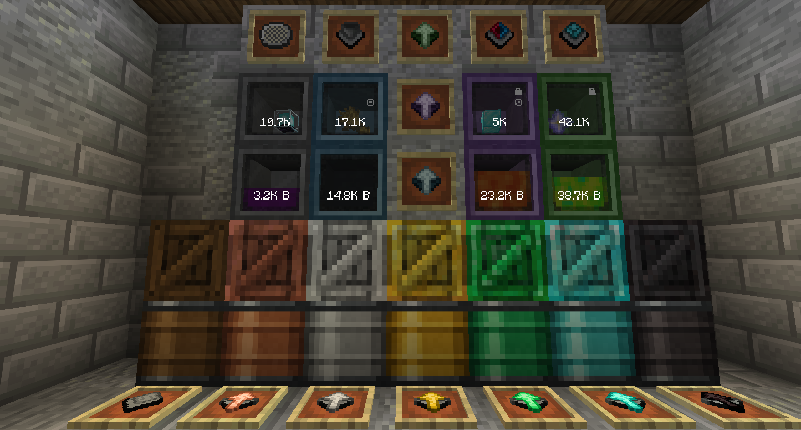

# Super Storage

A simple storage mod, inspired by the super chests and tanks from GTCEu with a twist.

## What's in it

**Crates** - Bigger chests. Seven tiers from wood to netherite.

**Drums** - Portable fluid tanks.

**Super Chests** - Hold a huge amount of a single item. Click the front to put stuff in or take it out, lock it to one item, void the overflow, and set each side to push or pull.

**Super Tanks** - Same idea as the super chests, but for fluids. Drums can be filled or emptied in the Super Tanks, like buckets, but more capacity.

Super chests, super tanks and drums all keep their contents when broken.

**Upgrade Kits** - Upgrade your crates, drums, super chests and super tanks to the next tier without emptying them.

**Crate Upgrades** - Hopper, collector and compacting. Pop them in the crate and click the tab to set them up.

**Filters** - Tell the crate upgrades what to grab, push, pull or compact.

**Tape** - Tape up a crate and it keeps its contents when broken.

## Config

Configurable capacities for the super blocks, plus speeds and ranges for the crate upgrades.